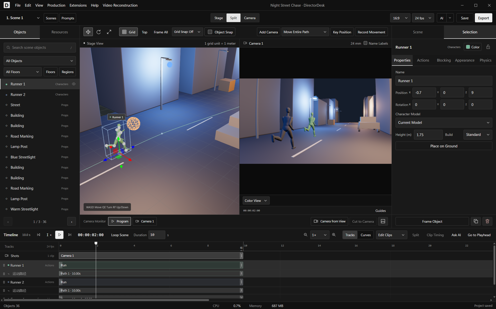
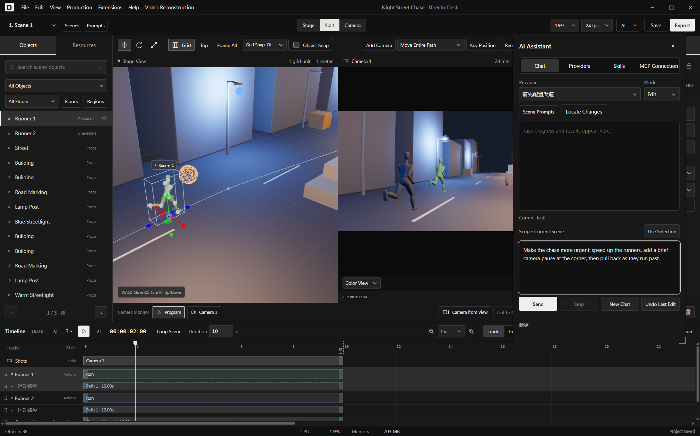
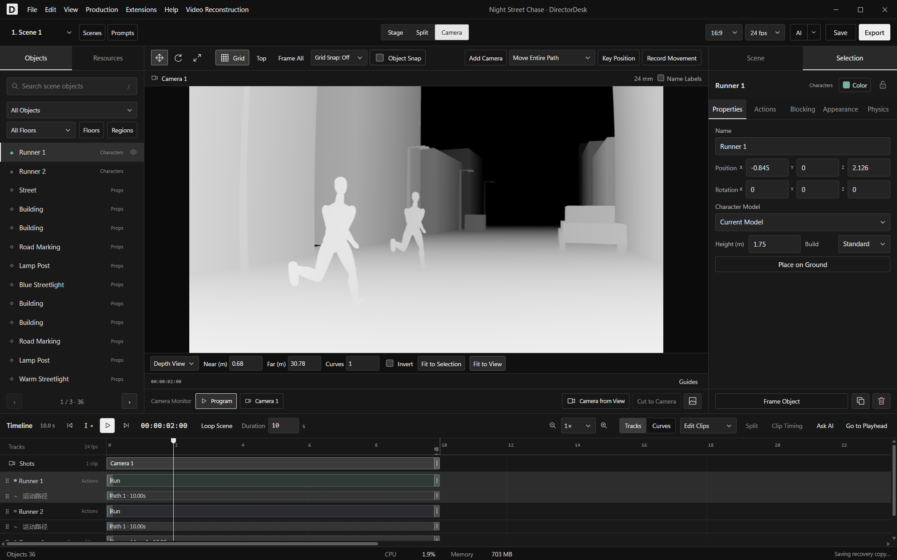
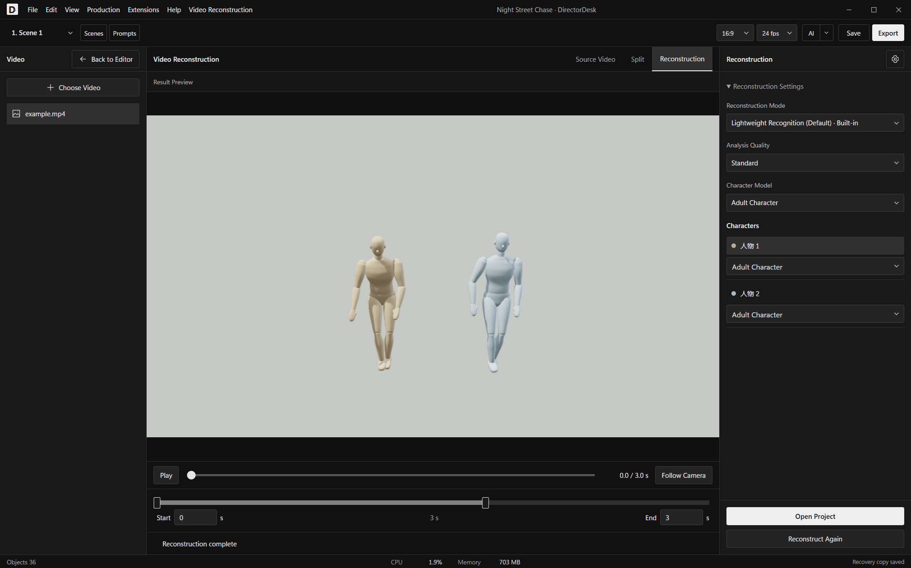

# DirectorDesk

[简体中文](README.md) · **English**

A 3D previsualization tool for AI video production. Build sets, block character movement, design camera work, and export reference videos with matching prompts. Work in the editor or let an AI agent edit the project directly.

[Download for Windows / Linux](https://github.com/mangfufu/director-desk/releases/latest) · [Release notes](https://github.com/mangfufu/director-desk/releases) · [Report an issue](https://github.com/mangfufu/director-desk/issues)

Latest release: [0.5.5.1](https://github.com/mangfufu/director-desk/releases/tag/v0.5.5.1).

## Features

| Feature | What you can do |
| --- | --- |
| Sets and assets | Use built-in characters, props, and templates; build with primitives or import GLB/glTF, FBX, and OBJ models |
| Blender scenes | Import sets, cameras, lights, and animation from a `.blend` file using your local Blender installation. No add-on required |
| Animation and blocking | Browse or import animations, draw movement paths, record keyboard-controlled movement, and adjust poses and physics |
| Cameras | Cut between cameras; use zoom, dolly zoom, handheld motion, lens distortion, and depth of field |
| Timeline | Drag, snap, select, split, and retime clips; control when objects appear and disappear |
| Visual effects | Add lighting, shadows, image and video surfaces, mirrors, particles, deformation, and keyframes |
| Projects and export | Work across scenes, continue from a previous scene’s final frame, save named versions, and batch-export color or depth video |
| Review | Use shot contact sheets, cached previews, and composition guides |

## Scene demos

Start from a blank set or open a template and change its characters, staging, and cameras. These demos are actual camera output from DirectorDesk, played at the original speed with reduced resolution and frame rate.

| Night Street Chase: running, tracking, and handheld motion | Suspense Corridor: dolly zoom |
| --- | --- |
|  |  |
| **Lighting Stage: lighting and camera changes** | **Bedroom: four-character blocking** |
|  |  |
| **Dusk Street** | **Courtyard** |
|  |  |
| **Forest Clearing** | **Empty Room** |
|  |  |

## AI-assisted editing

- **Built-in assistant:** configure a model provider, then describe the set, action, or camera changes you want. Target selected characters, clips, or a time range. Locate changes and undo them.
- **External agents:** connect Codex, Claude Code, or another MCP client to edit the current project. Copy the configuration from **AI → MCP Connection**. An included stdio bridge supports Claude Desktop.
- **Video prompts:** save separate reference-video and text-only prompts for each scene. The [bundled skill](skills/director-desk/) updates independently of the app; you can also import your own skills.

Combine AI and manual editing: ask an agent to build a street and block a chase, then adjust one camera yourself. Or select several clips and ask the agent to change just that part.

## Animation, blocking, and the timeline

Browse built-in animations and your own collection, hover to preview, and drag an action onto a character track. Insert clips between existing actions, preview the drop position, and shift later clips when needed. You can also import animation files or use animations included in an imported model.

- **Draw paths:** sketch a route, then refine its points, height, and timing. Paths can follow surfaces such as stairs and platforms.
- **Record movement:** control a character with the keyboard, use R / F to move up or down, and record the movement for further timeline editing.
- **Edit timing:** move selected clips together or drag their edges to adjust duration. Right-click to split at the playhead or delete clips.
- **Pose and physics:** adjust individual joints and enable gravity, collisions, inertia, or ragdoll motion for falls, throws, and force-driven movement.
- **Visibility clips:** control when an object appears or disappears without removing it from the project.

## Cameras, lighting, and visual effects

Switch between Stage, Split, and Camera views to edit the scene while checking the shot. Cut between multiple cameras, edit camera position and aim separately, and control where a move passes through, stops, accelerates, or slows down.

Use zoom, POV, dolly zoom, handheld motion, lens distortion, depth of field, and focus controls. Shape the image with lighting and shadows. Adaptive preview reduces the load while navigating or playing complex scenes and restores full detail when interaction stops.

Apply images and videos to a variety of object surfaces, with cropping, position, scale, rotation, and opacity controls. Combine mirrors, particles, lines, surfaces, and deformation, and animate their settings with keyframes.

## Color and depth video

Export the same scene, character movement, and camera work as a regular reference video or a grayscale depth video. Adjust the near and far range, invert black and white, or change the depth curve. Set the range from the current view or selected objects.

| Color view | Depth view from the same camera at the same time |
| --- | --- |
|  |  |

Export one scene or a batch, with control over filenames, resolution, and frame rate. Each scene keeps separate reference-video and text-only prompts for use with video generation models.

## Assets, projects, and extensions

| Task | How DirectorDesk helps |
| --- | --- |
| Bring in a Blender set | Choose a `.blend` file under **File → Import Blender Project**. DirectorDesk runs your local Blender installation to import models, basic colors and textures, cameras, lights, and animation into a separate scene by default |
| Reuse sets | Group objects, align or arrange them in batches, and save them to your set library |
| Work across scenes | Edit scenes independently or continue from the previous scene’s final frame, carrying over character and prop states |
| Keep alternatives | Save named project versions and restore them after restarting. Everyday edits also support undo and automatic recovery |
| Block a crowd | Generate ground-level routes around static obstacles and stagger character departures |
| Review shots | View shot images, timing, and notes in a contact sheet and export it as HTML. Enable composition guides as needed |
| Review complex sequences | Cache a selected time range and play it back in a loop |
| Extend the editor | Install plugins that add panels, tools, visual effects, and exporters. Import custom skills and enable or disable them as needed |

Blender import focuses on editable staging and basic appearance. Complex procedural materials are not reproduced exactly as they appear in the original renderer.

[Set editing guide](docs/staging-workflow.md) · [Physics and animation](docs/physics.md) · [Plugin API and examples](docs/plugins.md) — these guides are in Chinese.

## Get started

- **Windows:** run the installer, or extract the entire portable ZIP and run DirectorDesk.exe.
- **Linux x64:** make the AppImage executable and run it, or extract the tar.gz archive. Tested on Ubuntu 24.04 under WSL 2.
- **Language:** choose Chinese or English under **Edit → Settings → Language**. The app follows the system locale on first launch, using English outside Chinese locales. A saved preference takes priority.
- **Updates:** the Windows installer edition and Linux AppImage can download an update and restart to apply it. Portable editions are updated manually.

[Development and builds](docs/development.md) · [Plugin API](docs/plugins.md) · [Set editing guide](docs/staging-workflow.md) — these guides are in Chinese.

## Extract motion from video

Open **Video Reconstruction**, choose a video and a time range, review the preview, then open the result as an editable project. Replace character models, trim or retime animation clips, swap actions, and edit movement paths.

The default **Lightweight Recognition** uses [MediaPipe Pose Landmarker Lite](https://ai.google.dev/edge/mediapipe/solutions/vision/pose_landmarker). It is bundled with DirectorDesk: no separate installation or dedicated GPU is needed. Processing runs locally. It extracts character motion and approximate positions, without reconstructing the original set or camera movement. Manage installation, storage, and cleanup in Video Reconstruction settings.

## License and credits

DirectorDesk's original code is licensed under [MIT](LICENSE). Third-party components, models, and assets retain their own licenses:

- [MediaPipe · Apache 2.0](desktop/video-reconstruction/MediaPipe-LICENSE.txt)
- [Human3R](https://github.com/fanegg/Human3R) · [Non-commercial license](desktop/video-reconstruction/Human3R-LICENSE.txt)
- [FlowHMR](https://github.com/flowhmr/flowhmr) / [Windows port](https://github.com/xiaoerofficial021-collab/FlowHMR-Windows) · [Model license](desktop/video-reconstruction/FlowHMR-LICENSE.txt); SMPL+H body files have separate official license terms
- [Animation sources and licenses](src/animation/library/NOTICE.txt)

## Star History

Community: [Linux.do](https://linux.do/)
