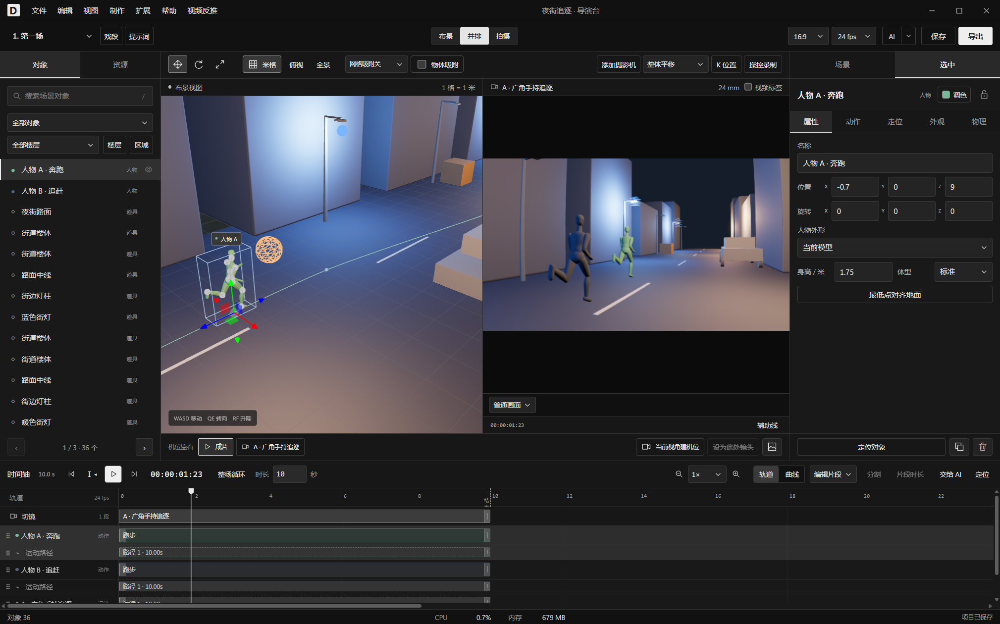
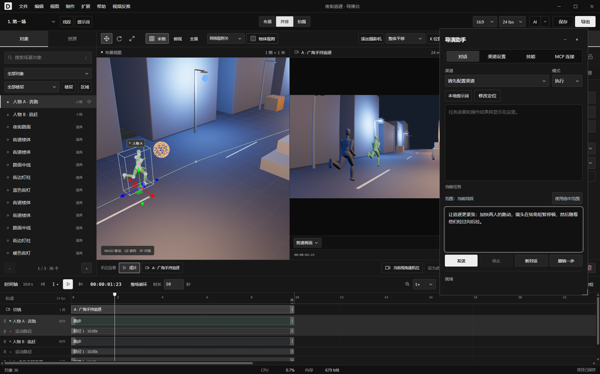
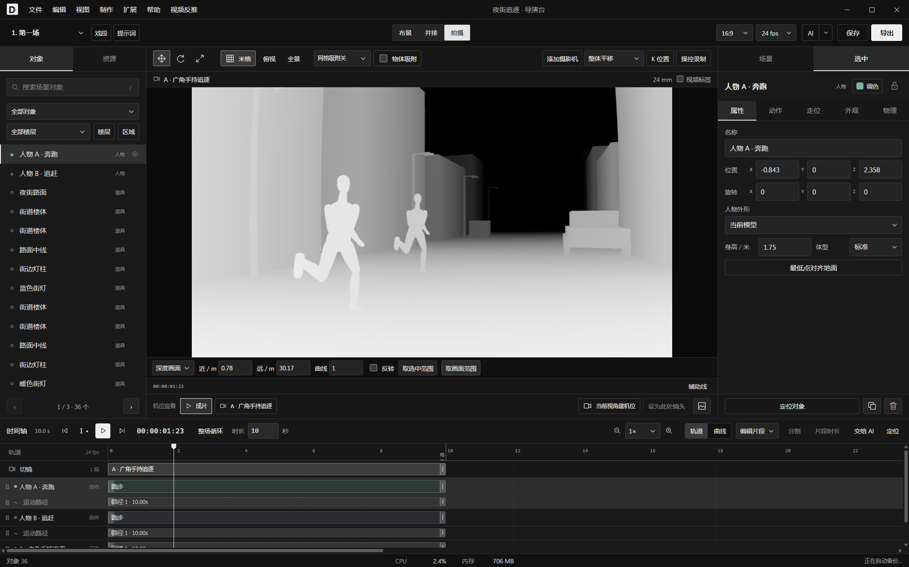
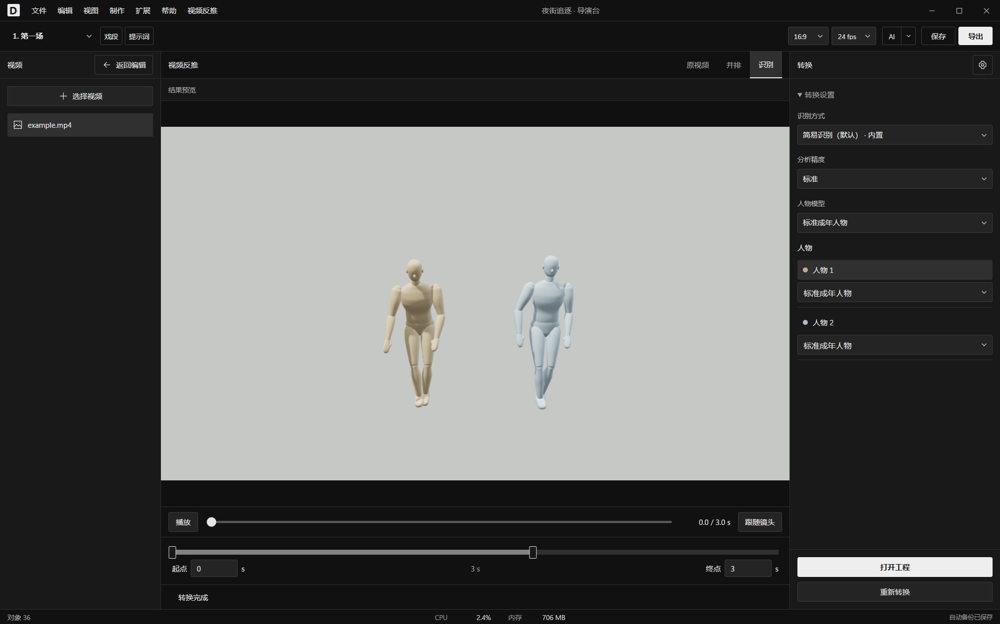

# 导演台 · DirectorDesk

**简体中文** · [English](README.en.md)

面向 AI 视频创作的三维预演工具。搭建场景、编排人物动作与走位、设计运镜，导出参考视频和配套提示词。支持手动编辑，也支持 AI 直接操作工程。

[下载 Windows / Linux 版](https://github.com/mangfufu/director-desk/releases/latest) · [更新记录](https://github.com/mangfufu/director-desk/releases) · [问题反馈](https://github.com/mangfufu/director-desk/issues)

当前发布版：[0.5.5](https://github.com/mangfufu/director-desk/releases/tag/v0.5.5)。

## 核心功能

| 功能 | 用途 |
| --- | --- |
| 场景与资产 | 内置人物、道具和场景模板；支持几何体搭景及 GLB/glTF、FBX、OBJ 模型导入 |
| Blender 工程 | 直接选择 `.blend`，借助本机 Blender 导入布景、摄影机、灯光和动画，无需安装插件 |
| 动作与走位 | 动作库、动作导入、手绘路径、键盘操控录制；调整姿势与物理效果 |
| 摄影机 | 多机位切镜、变焦、希区柯克效果、手持晃动、镜头畸变与景深 |
| 时间轴 | 拖放、吸附、多选、分割、速度曲线；控制对象出现和消失的时段 |
| 画面 | 灯光、阴影、图片与视频表面、镜面、粒子、形变及关键帧 |
| 工程与交付 | 多戏段、末帧接拍、命名历史版本；批量导出普通视频或深度视频 |
| 预览与检查 | 镜头联系表、局部预览缓存、构图辅助线 |

从模板或空白场景开始，安排人物和镜头，在时间轴调整节奏，预览后导出。

## AI 操作

- **内置助手**：配置模型渠道后，用自然语言搭景、安排动作和调整镜头。可指定人物、片段或时间范围，查看修改位置并撤销。
- **外部 Agent**：通过 MCP 连接 Codex、Claude Code 等客户端，直接编辑当前工程。在 **AI → MCP 连接** 复制配置；Claude Desktop 可使用内置 stdio 桥接。
- **配套提示词**：每场戏分别保存参考视频提示词和纯文字提示词。[内置 Skill](skills/director-desk/) 可独立检查更新，也可导入自己的 Skill。

查看内置助手

查看深度视频与模板演示

| 夜街追逐 | 悬疑长廊 |
| --- | --- |
|  |  |

动图为软件实际输出，原速播放，降低了分辨率和帧率。

## 安装与使用

- **Windows**：运行安装包，或完整解压便携 ZIP 后运行 DirectorDesk.exe。
- **Linux x64**：给 AppImage 添加执行权限后运行；也可解压 tar.gz 使用。已在 Ubuntu 24.04 / WSL 2 验证。
- **语言**：在 **编辑 → 设置 → 语言** 切换中文或英文。首次启动跟随系统语言，非中文环境默认英文，手动选择优先。
- **更新**：Windows 安装版和 Linux AppImage 支持下载并重启更新；便携版下载后手动替换。

[开发与构建](docs/development.md) · [插件接口](docs/plugins.md) · [布景操作](docs/staging-workflow.md)

## 视频提取动作

在 **视频反推** 中选择视频和时间区间，查看识别预览，完成后打开为可编辑工程。可更换人物外形，裁剪、调速或替换动作，继续编辑走位。

默认的**简易识别**基于 [MediaPipe Pose Landmarker Lite](https://ai.google.dev/edge/mediapipe/solutions/vision/pose_landmarker)，已随软件内置，无需额外安装，在本机运行，无需独立显卡。提取人物动作与近似位置，不还原原视频场景和运镜。安装、存储和清理在视频反推设置中管理。

## 许可与致谢

导演台自有代码采用 [MIT](LICENSE)。第三方组件、模型和素材遵循各自许可：

- [MediaPipe · Apache 2.0](desktop/video-reconstruction/MediaPipe-LICENSE.txt)
- [Human3R](https://github.com/fanegg/Human3R) · [非商业许可](desktop/video-reconstruction/Human3R-LICENSE.txt)
- [FlowHMR](https://github.com/flowhmr/flowhmr) / [Windows 适配](https://github.com/xiaoerofficial021-collab/FlowHMR-Windows) · [模型许可](desktop/video-reconstruction/FlowHMR-LICENSE.txt)；SMPL+H 人体文件另遵循其官方许可
- [动作素材来源与许可](src/animation/library/NOTICE.txt)

Star History

友链：[Linux.do](https://linux.do/)
